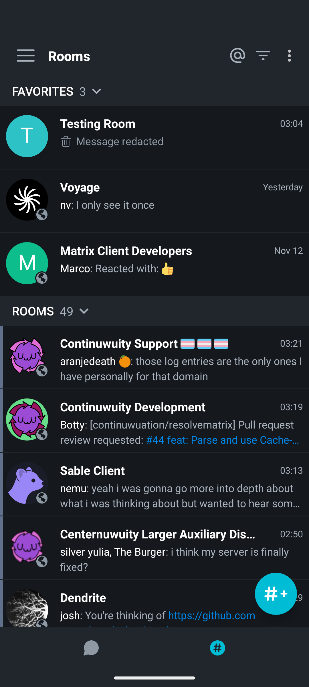
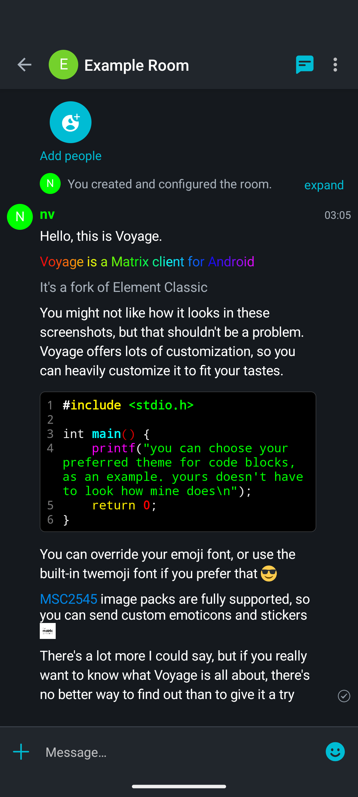
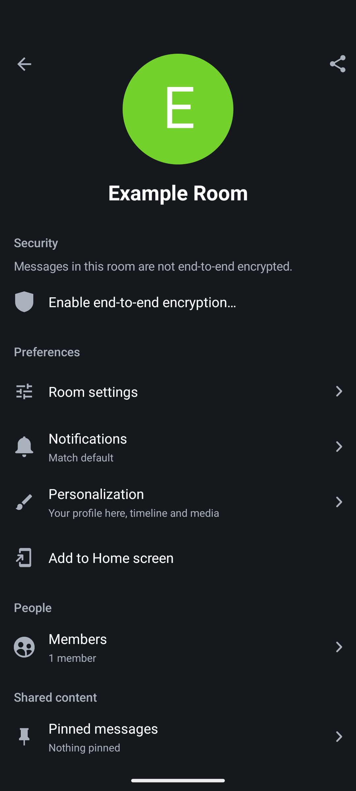
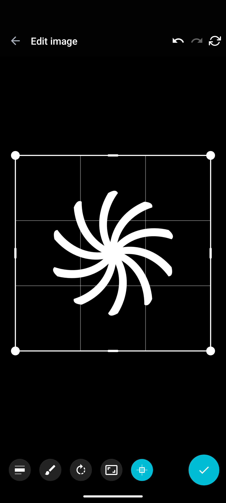

#  Voyage

[](https://matrix.to/#/#voyage:matrix.org)
[](#donations)

Voyage is a [Matrix](https://matrix.org/) client for Android, based on [Element Classic](https://github.com/element-hq/element-android). The app can be run on every Android device with Android 4.0 Ice Cream Sandwich and later (API 14).

[](https://f-droid.org/app/im.voyage.app)

<p align="center">
  
  
</p>
<p align="center">
  
  
</p>

# What's different

[CHANGES.md](CHANGES.md) lists the features, improvements and removals this fork
adds on top of Element Classic.

# Installing

Install Voyage from [F-Droid](https://f-droid.org/app/im.voyage.app), or grab an APK from the [releases](../../releases) tab.

Alternatively, build and install it yourself:

Build release APKs: `make`. Outputs are in `vector-app/build/outputs/apk/release/`.

Debug install: `make installDebug`

Release install: `make install`

Run linting with `make lint` and the unit test suite with `make test`.

# AI Disclosure

Voyage is developed utilizing LLMs/AI. If you are bothered by this, then I encourage you to find another client. First and foremost, I made this client out of my own personal desire to improve upon Element Classic, and LLMs allowed me to do so as an individual within a reasonable timespan. This client is more than anything else something I made for myself. I'm offering it to you to use it, because sharing is caring. You are not entitled to an LLM-free copy of my hobby project. All changes are reviewed by a human (me!), and QA testing is conducted before a release is tagged. I review all the strings I introduce into this app to ensure that their wording is satisfactory.

# Support

If you have any problems, I encourage you to report them in an issue, or to join the [Matrix room](https://matrix.to/#/#voyage:matrix.org) and ask about it there. Attaching a log export often helps diagnose a problem if it cannot be reliably reproduced. You can export your logs from `... > Export logs` on the main page of the app. The client cannot improve if you encounter a problem and choose to ignore it. I am one person, and this is a big codebase. I can only encounter so many bugs myself. As the feature set grows, so does the possibility of introducing bugs.

# Running on Android 4.0–4.3

On Android 4.0–4.3 (API 14–18) the app currently requires the device's Dalvik
bytecode verifier to be disabled, or it crashes when opening a room.

Disabling verification requires **root**. Voyage automatically prompts for and
applies this on first launch. Therefore, you must be rooted to use Voyage on
Android 4.0-4.3.

To re-enable verification, delete the file (if it holds nothing but this line)
and reboot:

```
adb shell su
rm /data/local.prop
reboot
```

# Donations

Monero:

```
85Em2xoemw7AvSrQL417MtLc1ytfT3TzBUiZU67q4tKTKNpwx6TQjKqasrTk1FUvnNdenESV6d4k8fFuoXbLowXT32AtCbb
```
